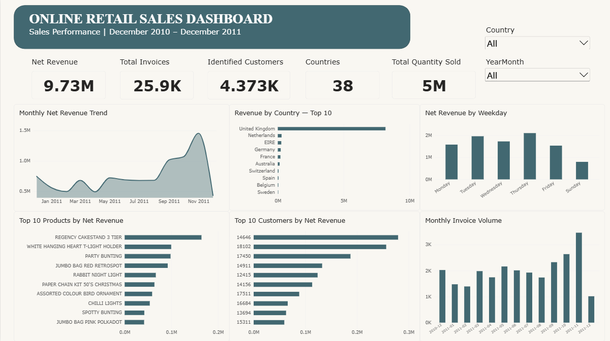

# Online Retail Data Analysis

## Project Overview

This project analyzes online retail transactions to understand sales performance, customer purchasing behavior, product performance, and business trends. It uses Python for data cleaning and exploratory data analysis (EDA), and Microsoft Power BI to create an interactive dashboard.

The project is organized into separate tasks to demonstrate the complete data analysis workflow, from raw data preparation to interactive business reporting.

## Project Objectives

- Clean and prepare the raw online retail dataset for analysis.
- Explore sales, customer, product, country, and time-based trends.
- Identify top-performing products and customers.
- Analyze monthly revenue and invoice volume.
- Build an interactive Power BI dashboard to communicate key business insights.

## Dataset

**Dataset:** Online Retail

**Source:** [UCI Machine Learning Repository — Online Retail](https://archive.ics.uci.edu/dataset/352/online+retail)

The dataset contains transactional records from a UK-based online retailer between December 2010 and December 2011.

Key columns include:

- `InvoiceNo` — Invoice or transaction identifier
- `StockCode` — Product identifier
- `Description` — Product description
- `Quantity` — Quantity purchased or returned
- `InvoiceDate` — Transaction date and time
- `UnitPrice` — Price per unit
- `CustomerID` — Customer identifier
- `Country` — Customer's country

Additional columns and flags were created during data preparation and analysis.

## Tools and Technologies

- **Python:** Data analysis and cleaning
- **Pandas and NumPy:** Data manipulation and numerical operations
- **Matplotlib and Seaborn:** Exploratory data visualization
- **Jupyter Notebook:** Analysis and documentation
- **Microsoft Power BI:** Interactive dashboard development
- **Git and GitHub:** Version control and project documentation

## Project Structure

```text
Online-Retail-Data-Analysis/
│
├── Task-1-Data-Cleaning/
│   ├── README.md
│   ├── online_retail_data_cleaning.ipynb
│   └── cleaned_online_retail.zip
│
├── Task-2-Exploratory-Data-Analysis/
│   ├── README.md
│   └── online_retail_eda.ipynb
│
├── Task-3-Interactive-Dashboard/
│   ├── README.md
│   └── Online_Retail_Dashboard.pbix
│
├── .gitignore
├── online_retail.csv
└── README.md
```

## Tasks Completed

### Task 1: Data Cleaning and Preparation

**Folder:** [`Task-1-Data-Cleaning`](./Task-1-Data-Cleaning/)

The raw dataset was cleaned and prepared for further analysis.

Key activities:
- Inspected the dataset structure, data types, and missing values.
- Removed duplicate records.
- Converted transaction dates to the appropriate datetime format.
- Reviewed missing product descriptions and customer identifiers.
- Created flags for zero-price, negative-price, negative-quantity, and unusually high-quantity records.
- Calculated revenue using quantity multiplied by unit price.
- Validated the cleaned dataset before saving it.

**Result:** The cleaned dataset contains 536,641 rows and 13 columns. Unusual transactions and returns were retained for analysis rather than automatically deleted.

### Task 2: Exploratory Data Analysis (EDA)

**Folder:** [`Task-2-Exploratory-Data-Analysis`](./Task-2-Exploratory-Data-Analysis/)

Exploratory analysis was performed to identify patterns and trends in the cleaned data.

Key analyses:
- Monthly net revenue trends
- Revenue by country
- Top products by net revenue
- Top products by net quantity
- Top customers by net revenue
- Revenue by weekday
- Monthly invoice volume
- Revenue per invoice
- Customer purchasing frequency
- Correlation analysis and unusual transaction values

**Key findings:**
- Total net revenue was approximately **9.73 million** in the dataset's currency.
- The United Kingdom contributed approximately **84%** of net revenue.
- November 2011 had the highest monthly net revenue and invoice volume.
- Thursday recorded the highest net revenue among the observed weekdays.
- The Regency Cake Stand 3 Tier was the highest-revenue merchandise product after excluding postage-related codes.
- The dataset contains returns and cancellations, which affect net revenue and net quantity.

*Note: December 2011 data ends on December 9, so December is a partial month. Net revenue includes negative transactions.*

### Task 3: Interactive Power BI Dashboard

**Folder:** [`Task-3-Interactive-Dashboard`](./Task-3-Interactive-Dashboard/)

An interactive dashboard was developed in Microsoft Power BI to present the key findings in a business-friendly format.

Dashboard components:
- **KPI cards:** Net Revenue, Total Invoices, Identified Customers, Countries, and Total Quantity Sold
- **Monthly Net Revenue Trend:** Shows how net revenue changes over time
- **Revenue by Country:** Compares the top 10 countries by net revenue
- **Net Revenue by Weekday:** Highlights differences in revenue across weekdays
- **Top 10 Products by Net Revenue:** Identifies leading merchandise products
- **Top 10 Customers by Net Revenue:** Shows the highest-value identified customers
- **Monthly Invoice Volume:** Tracks invoice activity by month
- **Interactive slicers:** Filter the dashboard by country and year-month

The dashboard allows users to explore sales performance across different countries and periods.

### Dashboard Preview



**Dashboard File:** [Online_Retail_Dashboard.pbix](./Task-3-Interactive-Dashboard/Online_Retail_Dashboard.pbix)

### Task 4: Final Data Analytics Case Study

**Folder:** [`Task-4-Final-Case-Study`](./Task-4-Final-Case-Study/)

This final case study brings together the complete data analytics workflow, from data cleaning and exploratory analysis to interactive Power BI reporting.

It includes:
- Problem statement and dataset information
- Data cleaning and preparation process
- Exploratory data analysis and key findings
- Power BI dashboard overview
- Business insights and recommendations
- Project conclusion and tools used

## Data Quality and Interpretation Notes

- Customer identifiers are missing for some transactions; customer-level analysis uses identifiable customers only.
- Negative quantities generally reflect returns or cancellations and are retained in net calculations.
- December 2011 is incomplete and should not be compared directly with full months.
- Unusually large transaction values were reviewed rather than automatically removed.
- Customer invoice counts do not necessarily represent successful purchases because cancellation transactions may be included.
- Revenue is calculated as `Quantity × UnitPrice`.

## How to Explore the Project

1. Open the Task 1 notebook to review the cleaning process.
2. Open the Task 2 notebook to explore the analysis and visualizations.
3. Download `Online_Retail_Dashboard.pbix` from Task 3 and open it using Microsoft Power BI Desktop.
4. Use the country and year-month slicers to interact with the dashboard.

## Skills Demonstrated

- Data cleaning and preprocessing
- Exploratory data analysis
- Data aggregation and summarization
- Data visualization
- KPI development and dashboard design
- Business insight communication
- Jupyter Notebook documentation
- GitHub project organization

## Conclusion

This project demonstrates an end-to-end data analysis workflow using Python and Power BI. The analysis identifies important revenue, product, customer, country, and time-based patterns, while the interactive dashboard presents the results in a format suitable for business decision-making.

The project provides practical experience in transforming raw transaction data into actionable insights and communicating those insights through visual analytics.

---

**Project:** Online Retail Data Analysis  
**Tools:** Python, Pandas, NumPy, Matplotlib, Seaborn, Jupyter Notebook, Power BI, GitHub  

